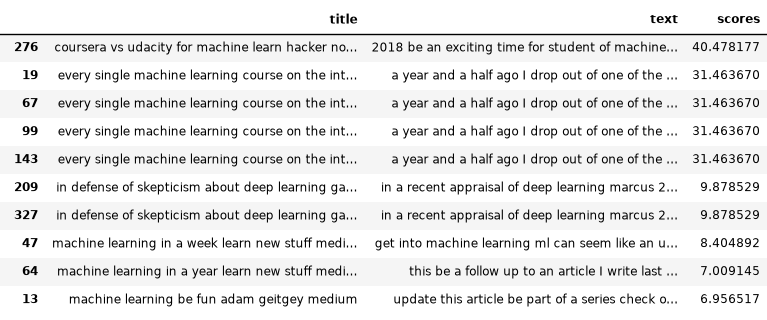

# Cvičení 4 - TF-IDF a invertovaný index

Cílem cvičení je naprogramovat jednoduchý vyhledávač: předzpracovat text, vytvořit invertovaný index a seřadit dokumenty podle skóre TF-IDF. Úlohu 1 zvládnete na vlastním počítači na malé sadě článků, v úloze 2 stejný postup spustíte na MetaCentru nad celou anglickou Simple Wikipedií.

Potřebné knihovny: `spacy` (model `en_core_web_sm`), `pandas`, `datasets`

## Úloha 1 - Vyhledávání v článcích z Medium

### Načtení a příprava dat

Po rozbalení [`archive.zip`](archive.zip) získáte soubor `articles.csv`. Pochází z [Kaggle datasetu](https://www.kaggle.com/hsankesara/medium-articles) a obsahuje malé množství článků z Medium k tématům ML, AI a data science. Stačí vám sloupce `title` a `text`.

Napište funkci pro předzpracování textu, kterou pak použijete i na vyhledávaný dotaz:

1. převeďte text na malá písmena,
2. interpunkci a speciální znaky (apostrofy apod.) nahraďte mezerou,
3. proveďte lemmatizaci pomocí knihovny spaCy a vynechte tokeny tvořené jen bílými znaky.

```python
import re
import spacy
nlp = spacy.load("en_core_web_sm", disable=["parser", "ner"])

text = re.sub(r"[^\w\s]", " ", text.lower())
" ".join(token.lemma_ for token in nlp(text) if not token.is_space)
```

Jde o jednoduchý preprocessing, v praxi bývá kroků víc (tento by měl problém např. s čísly).

### Invertovaný index

Vytvořte invertovaný index: slovník, kde klíčem je slovo a hodnotou seznam id dokumentů, které slovo obsahují. Vytvořte dva indexy, jeden pro `title` a druhý pro `text`.

### TF-IDF

Napište funkci `tf_idf`, která pro dotaz, jeden invertovaný index a dané dokumenty vrátí skóre každého dokumentu:

$$
score(q,d) = TF\_IDF(q,d) = \sum\limits_{w \in q \cap d} c(w, q)\, c(w, d)\, \log\!\left(\frac{M+1}{df(w)}\right)
$$

- $q$ - dotaz, $d$ - dokument,
- $c(w, q)$, $c(w, d)$ - kolikrát je slovo $w$ v dotazu, resp. v dokumentu,
- $M$ - celkový počet dokumentů,
- $df(w)$ - počet dokumentů, které obsahují slovo $w$.

### Vyhledávání

Skóre titulku a textu spojte do jednoho skóre dokumentu pomocí parametru $\alpha$:

$$
score(q,d) = \alpha \; TF\_IDF\_title(q,d) + (1-\alpha) \; TF\_IDF\_text(q,d)
$$

Pro $\alpha = 0.7$ a dotaz `coursera vs udacity machine learning` by výsledky měly vypadat takto (spaCy 3.8, model `en_core_web_sm` 3.8.0; s jinou verzí nebo jiným předzpracováním se skóre mohou mírně lišit):



## Úloha 2 - Velký korpus na MetaCentru

Stejný vyhledávač postavte nad anglickou [Simple Wikipedií](https://huggingface.co/datasets/wikimedia/wikipedia/tree/main/20231101.simple) (přes 240 000 článků, 157 MB). Data načtete knihovnou `datasets`:

```python
from datasets import load_dataset
wiki = load_dataset("wikimedia/wikipedia", "20231101.simple", split="train")   # sloupce id, url, title, text
```

Nejpomalejší částí je lemmatizace. Na jednom jádře by trvala hodiny, proto ji spusťte na MetaCentru paralelně. spaCy umí zpracovávat texty po dávkách ve více procesech:

```python
docs = nlp.pipe(texty, batch_size=200, n_process=16)
```

1. Napište skript, který předzpracuje titulky i texty všech článků, vytvoří oba invertované indexy a uloží je (např. pomocí `pickle`). Do indexu si rovnou uložte i počty výskytů $c(w, d)$, ať je při vyhledávání nemusíte počítat znovu.
2. Skript spusťte na MetaCentru jako dávkovou úlohu s více jádry (např. `ncpus=16`). Počet procesů `n_process` nastavte podle počtu přidělených jader.
3. Změřte, jak rychle běží předzpracování na 1, 4 a 16 jádrech. Stačí na prvních 10 000 článcích, celý korpus pak zpracujte jen na 16 jádrech. Výsledky shrňte do tabulky (čas, zrychlení oproti 1 jádru) a okomentujte, proč zrychlení není přesně úměrné počtu jader.
4. Uložené indexy načtěte v notebooku a vyzkoušejte vyhledávání na několika vlastních dotazech.

## Odevzdání

Do svého repozitáře nahrajte složku `cv04`, která bude obsahovat:
- Jupyter notebook s úlohou 1 a vyhledáváním nad Wikipedií,
- skript pro vytvoření indexu a PBS skript,
- výstupní logy úloh z MetaCentra,
- tabulku s časy a zrychlením,
- 3 ukázky výsledku vyhledávání vlastních dotazů.

Data ani uložené indexy do repozitáře nenahrávejte, jsou příliš velké.
